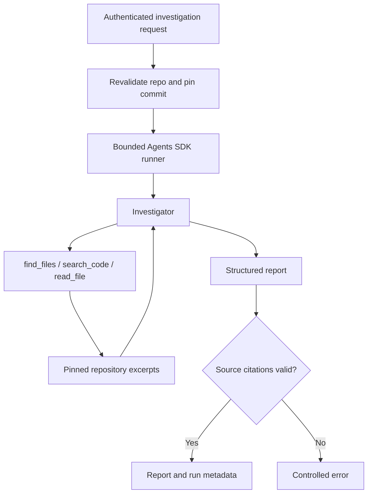

# RepoFix AI

RepoFix AI is an agentic developer tool for investigating GitHub issues. A
developer connects GitHub, selects a public repository, describes a problem,
and receives a structured source-based hypothesis or an explanation of missing
evidence. The agent discovers files, searches selected source and reads code through bounded tools.

**Current stage:** the read-only investigation backend is implemented, tested
offline and has returned live source-grounded reports using OpenAI Responses
with GPT-6 Luna, including a run that used content search successfully. The
focused smoke requests explicitly had no reproduced bug; accepted reports
returned `insufficient_evidence`, null root causes and source citations that
passed independent grounding. This verifies the read-only workflow, not
diagnosis accuracy or a resolved GitHub issue. A later controlled demo case
correctly identified a known quantity-boundary defect; the single-case result
is recorded below, with broader diagnosis evaluation still pending.

The proposal model, source validator, saved-commit preparation and bounded AI
draft generator, account-scoped proposal persistence and generation/list/detail
APIs are implemented and tested offline. Live proposal verification, sandbox
validation, review/approval and optional draft PR creation remain pending. Current repository access is read-only.

## What is implemented

- GitHub OAuth login with browser-bound state, PKCE, session cookies and logout.
- Paginated public repositories owned by the connected GitHub user account.
- Repository selection revalidation using the listed repository ID and name.
- A fixed commit, bounded repository tree and hash-verified UTF-8 file reads.
- One OpenAI Agents SDK Investigator with `find_files`, `search_code` and
  `read_file` tools.
- A bounded reasoning/tool loop with deadlines and per-run read budgets,
  reserving the final configured model turn for reporting without tools.
- Strict structured reports and independent checks of source citations against
  excerpts actually returned during that run. Agent-visible source lines include
  explicit file line numbers while canonical evidence remains unchanged.
- Run metadata: logical model calls, tool attempts, repository counters, elapsed
  time and metadata events for completed investigations.
- Explicit Gemini/OpenAI provider selection without automatic paid fallback.
- Limited retries for supported transient Gemini errors, with a shared run budget.
- Controlled quota, availability, timeout and report-validation HTTP responses.
- SQLite history for completed grounded reports, scoped to the connected GitHub account.
- Strict fix-proposal contracts, saved-commit context, bounded AI draft generation,
  fresh-read/source validation and deterministic review diffs, verified offline.
  Account-scoped proposal generation, storage and list/detail APIs are implemented offline.
- FastAPI documentation and offline component/HTTP/SDK integration tests.

A probable cause is a hypothesis supported by inspected source. It does not mean
the issue was reproduced or a fix was verified. `insufficient_evidence` is a
valid completed report when the available source cannot support a hypothesis.

The next backend feature has begun with `app/fix_proposal.py` and its offline
contract tests. `FixProposalInput` accepts only `investigation_run_id`; context
preparation now loads the account-scoped record and its stored repository/commit.
The HTTP layer supplies its session-derived identity. `FixProposal` contains proposed edits, new regression-test file text,
verification steps, risks and limitations, with status `proposed` only.
Source anchors are preserved exactly. The separate pure validator now verifies anchors against supplied pinned source
and builds a deterministic diff; no unchecked model-authored diff is accepted.
The generator now connects prepared context, repository tools and diff validation.
Its HTTP session/admission layer, proposal persistence and API are now implemented;
live generation and review still need manual verification.

First draft limits: at most five edits and three new test files, one contiguous
replacement per target file, 12,000 characters per before/after excerpt, 24,000
per test file and a 96 KiB serialized UTF-8 budget. Portable relative paths and
the existing supported-text/sensitive-path policy are checked. Duplicate paths,
case-only collisions, file/directory target collisions, no-op edits and invalid
source controls are rejected. Empty replacement text allows an exact deletion.
Schema validity alone does not prove that an anchor exists or is unique. The
separate source validator checks those properties; semantic correctness and test
execution still require later validation.

Save `fix_proposal.py` under `backend/app` and `test_fix_proposal.py` under
`backend/tests`. Existing API files, private settings and dependencies need no
changes for this isolated step. From the activated backend terminal:

```powershell
python -c "from app.fix_proposal import FixProposal; from agents import AgentOutputSchema; print('Proposal schema strict:', AgentOutputSchema(FixProposal).is_strict_json_schema())"
python -m pytest tests/test_fix_proposal.py
python -m pytest
```

Assistant verification on 22 October: 72 proposal-contract cases passed in 1.23s;
full assistant suite 885 passed in 6.95s. Windows subsequently passed the 72
proposal cases in 8.35s and **867 total in 25.62s**, with a strict SDK schema.
The 18-case checkout difference still applies. No proposal endpoint is available
for Swagger yet.

`app/proposal_validation.py` now provides `validate_fix_proposal` as a pure
source-checking and diff-building function. It takes an account-scoped saved
history record, a complete bounded tree for its commit, the full original files
targeted by edits, and a draft. The future authenticated service must supply
those trusted inputs through the existing history store and GitHub readers.
This function does not itself look up an account, fetch GitHub or validate a
cryptographic commit/tree chain independently of that service.

The validator requires a saved `likely_cause` report and matching repository and
commit provenance. It checks regular file modes, tree/blob identity, UTF-8 byte
sizes and actual Git blob hashes. Missing, repeated and overlapping anchors are
rejected without fuzzy matching. New test files cannot replace existing objects
or traverse symlinks/submodules, case aliases or file/directory conflicts.

A server-built artifact contains original/proposed contents and blob hashes,
server-derived run/repository/base-commit identifiers, a canonical Git unified
diff and a SHA-256 digest of patch bytes. Original modes, line endings, Unicode
paths and missing final newlines are handled explicitly. Each file is limited
to 100 KiB; original source, proposed content and diff each have separate
256 KiB aggregate budgets. The patch digest is not approval or proof of a fix.
The function does no I/O and does not execute syntax checks, tests or patches.

Save `proposal_validation.py` in `backend/app` and its test file in
`backend/tests`. Verify from the activated backend terminal:

```powershell
python -c "from app.proposal_validation import validate_fix_proposal, ProposalValidationError; print('Proposal source validator import OK')"
python -m pytest tests/test_proposal_validation.py
python -m pytest
```

Assistant verification: 58 validator tests; full suite **943 passed in 6.60s**.
Seven cases check/apply generated patches only to temporary synthetic files
through Git and compare exact output bytes. They skip if Git CLI is unavailable;
no target repository code/tests or generated test code runs. Windows subsequently
passed all 58 validator cases in 13.17s and **925 total in 30.30s**, with no skips
or warnings shown.

`app/proposal_context.py` now implements the preparation layer as
`prepare_proposal_context(identity, payload, history_store)`. It reads saved
history using the numeric account ID, rejects missing/other-account and
insufficient-evidence runs before GitHub access, and revalidates current public
repository ownership before and after reading the saved commit's bounded tree.
The saved SHA is passed directly to the existing commit/tree reader; no branch
head is captured. A moved/default-changed branch cannot silently change the base.

The result carries the saved history and an `InvestigationContext` compatible
with existing bounded repository/SDK tools. Preparation itself makes only
metadata/tree reads, not file downloads or model calls. The API authenticates the session, enforces admission/deadlines, runs synchronous
preparation in its worker and rechecks login before paid generation. Repository/account
renames are conservatively rejected for proposals if the stored full name no
longer matches; history remains readable and a fresh investigation is needed.

Save the two new files at `backend/app/proposal_context.py` and
`backend/tests/test_proposal_context.py`, then verify:

```powershell
python -c "from app.proposal_context import prepare_proposal_context, ProposalContextError; print('Proposal context import OK')"
python -m pytest tests/test_proposal_context.py
python -m pytest
```

Assistant verification on 23 October: **42 context cases in 1.30s; 985 full-suite
cases in 6.37s**. Tests use isolated SQLite and mocked GitHub responses, including
wrong-account access, branch drift, changed ownership and wrong/truncated trees.
Windows subsequently passed all 42 context cases in 4.51s and **967 total in
18.32s**, with no warnings or skips shown. No proposal Swagger endpoint or live
AI call was introduced at that checkpoint.

`app/proposal_generator.py` now provides the internal async
`generate_fix_proposal` runner. It takes server-prepared `ProposalContext` and
validated settings, copies/rechecks eligibility and provenance before model work,
uses only bounded find/search/read tools, and returns a `ProposalGenerationResult`
containing a generated proposal ID, validated diff artifact and metadata events.
Storage and authenticated endpoints are implemented in the following checkpoint.

Unlike investigation citation displays, proposal reads preserve exact decoded
line endings, indentation and final newlines. Every edit anchor must occur in a
successful `read_file` excerpt from this generation run. Stored citations, search
previews, denied reads and unobserved parts of a cached file cannot authorize an
edit. The existing source validator then checks unique anchors against full
verified blobs and generates the canonical diff. Syntax/semantic correctness and
test execution remain unverified. Rejected drafts are not automatically repaired
with another paid request.

The runner uses existing selected-provider settings, the turn/deadline/tool/read
budgets and metadata hooks. At least two turns are required to allow a fresh read
and a final draft; the final configured turn disables tools. Maximum draft output
is 8,192 tokens. Tracing is disabled and credentials are supplied explicitly to a
run-scoped provider. OpenAI uses Responses, store=False and no automatic retries;
Gemini uses the existing Chat Completions provider, omits store and retains its
shared bounded transient-retry policy. There is no automatic paid fallback.
The deadline covers model/tool work and awaited source validation, but cannot
terminate a synchronous GitHub read or validation worker already running.

Save the new source and tests in `backend/app` and `backend/tests`, then run:

```powershell
python -c "from app.proposal_generator import generate_fix_proposal, ProposalGenerationError; print('Proposal generator import OK')"
python -m pytest tests/test_proposal_generator.py
python -m pytest
```

Assistant verification on 23 October: **36 generator cases passed in 2.02s; full
suite 1,021 passed in 7.71s**. Tests run the actual Agents SDK loop with fake models
and mocked GitHub reads; no live model request, target execution, patch application
or GitHub write occurs. Windows subsequently passed 36 generator cases in 10.66s
and 1,003 total in 43.39s. Live proposal quality remains pending. The assistant
checkout still has 18 additional legacy cases. Proposal persistence and API
integration follow below.

## Saved fix proposals — offline integration complete

New `app/proposal_history.py`, `app/proposal_store.py` and `app/api/proposals.py`
connect the generator to immutable, account-scoped SQLite drafts. Updated
`app/config.py` and `app/main.py` compose and close the app-owned proposal store.
No dependency installation or private `.env` edit is needed. The default database
is `backend/data/proposals.db`, separate from investigation history. Optional
`REPOFIX_PROPOSAL_DATABASE_PATH` uses the same stable relative-path policy as
history. Database paths must differ; existing history is not migrated or erased.

A saved record retains the proposal/run/repository IDs, original commit/tree,
draft, original/proposed files, deterministic unified diff, SHA-256 patch digest,
UTC creation time, counters, duration and metadata events. Full detail is limited
to 2 MiB, with existing per-file/source/proposed/diff limits retained. Saving and
retrieval recheck draft/change/blob/diff consistency, including exact whitespace
and CRLF; these are consistency checks on a trusted server artifact, not a new
remote attestation or proof that the code works. Inserts never overwrite a draft.

Generation requires the session, one trusted Origin and `X-RepoFix-CSRF: 1`.
It preflights proposal storage before GitHub/AI, prepares the account's saved
likely-cause report at its original SHA and rechecks the session before the paid
call. Result repository/run/commit/tree IDs must match prepared context. The
existing single active slot and six-attempts/hour/account budget are shared with
investigation runs, including failed preparations. They reset on restart and
are not a spending cap or multi-process deployment limit.

If disk access fails after generation, HTTP 200 still returns the verified draft
with `proposal_saved=false`. A save timeout also returns false conservatively;
the pending write can complete, so refresh list/detail before repeating a paid
request. Pending shielded preparation/save workers retain the active slot until
they finish. Failed generation is not stored or automatically retried/repaired.
Provider quota/wait errors keep the existing safe status and Retry-After mapping.

| Method and path | Behavior |
| --- | --- |
| `POST /api/proposals/generate` | Generate and save a draft from only `investigation_run_id` |
| `GET /api/proposals?page=1&per_page=20` | List this account's saved draft summaries |
| `GET /api/proposals/{proposal_id}` | Retrieve full saved draft, exact files and diff |

List/detail require login but no AI configuration, provider request or GitHub
read. Other-account and missing IDs both return 404. A restart requires GitHub
login again; stored proposals survive. All outcomes remain proposals: no target
patch, test execution, approval, commit or PR occurs. The digest identifies patch
bytes and is not approval. Repeated explicit generation creates a separate ID.

Install the five new files at their matching `backend/app`, `backend/app/api` and
`backend/tests` locations; replace only `backend/app/config.py` and
`backend/app/main.py`. Keep your private `.env` and existing history database.
Then, from the activated backend terminal:

```powershell
python -c "from app.main import app; p = app.openapi()['paths']; print('Generate:', '/api/proposals/generate' in p); print('List:', '/api/proposals' in p); print('Detail:', '/api/proposals/{proposal_id}' in p)"
python -m pytest tests/test_proposal_store.py tests/test_proposal_api.py
python -m pytest
```

Assistant verification: **49 store/record/config cases + 55 HTTP cases = 104
passed**; full suite **1,125 passed in 9.99s**. Tests use temporary SQLite,
mock preparation/generation and blocked network, with no paid calls or generated
code execution. Windows subsequently verified all three registered routes,
**104 targeted tests in 13.72s** and **1,107 total in 47.78s** on 31 October 2026,
with no warnings/skips shown. The 18 pre-existing assistant cases account for
the checkout difference. Live proposal generation/save/retrieval remains pending.

After those checks, start normal Uvicorn:

```powershell
python -m uvicorn app.main:app --host 127.0.0.1 --port 8000
```

Open `http://127.0.0.1:8000/docs`, reconnect GitHub through browser navigation,
and execute `POST /api/proposals/generate` once with `X-RepoFix-CSRF` set to `1`:

```json
{"investigation_run_id":"949231f0c7bb494dad0c93f068f3b47b"}
```

Swagger supplies the same-origin browser Origin; do not paste tokens into the
body. This existing controlled-demo run should be loaded, rather than paying
for another investigation. Verify `status=proposed`, `proposal_saved=true`, the
original base SHA, a quantity-boundary correction and plausible test draft;
then list proposals and open its returned proposal ID. Review actual output
before drawing conclusions. A generated test file is not a passing test. Live
proposal quality, manual persistence/re-login checks and approval/sandbox work
remain pending.

## Saved-history event validation correction (31 October 2026)

The first manual proposal generation returned HTTP 502 with
`The saved proposal context could not be verified.`, although GET of the saved
investigation succeeded. The returned record included nonempty InvestigationEvent
dataclasses. The old deep-copy check converted them to dictionaries with
model_dump(), then strict Python validation rejected those dictionaries with
`dataclass_exact_type`. Earlier success fixtures contained empty event lists,
which missed this real workflow boundary. This is a local validation defect,
not evidence of a model/provider failure; that context error is raised before
proposal generation calls the AI provider.

Updated `app/proposal_context.py` and `app/proposal_validation.py` share the
corrected deep-revalidation helper. Only event dictionaries are rebuilt through
a strict TypeAdapter JSON boundary. All other values retain Python strict
validation, so bool/string mutations cannot turn into valid repository IDs,
file sizes or counts. Source/ownership/provenance checks and public API responses
are unchanged. No database rewrite, dependency update or new investigation is
required.

Replace both source files and the three matching proposal context/validation/
generator test modules. Success fixtures now contain nonempty events. Six new
cases include a full FastAPI -> real saved-context preparation -> actual Agents
SDK fake-provider loop -> source validator -> SQLite save/list/detail flow, plus
strict malformed-event rejection. The integrated case reproduced the same 502
before the correction and passes after it. Mocked GitHub and fake model outputs
are used; no paid request or target code/test execution occurred.

Assistant verification: **142 focused in 2.06s; 1,131 total in 8.41s**, each with
one environment AnyIO/pytest deprecation warning. Latest Windows baseline is
still 1,107; installation/regression tests and live proposal retry after this fix
remain pending. From the activated backend terminal:

```powershell
python -m pytest tests/test_proposal_context.py tests/test_proposal_validation.py tests/test_proposal_generator.py
python -m pytest
```

Then restart normal Uvicorn, reconnect GitHub and retry proposal generation
once with the existing saved run ID shown above. Successful live generation,
proposal_saved, list/detail and persistence after re-login still need to be
observed. Do not treat the offline result as a verified fix to the target repo.

## Current architecture

The Investigator merges issue triage, repository analysis and root-cause
hypotheses. Tools perform deterministic repository operations; the runner owns
budgets, provider lifetime and evidence validation. Extra agents are deferred
until patch authoring or independent review creates a useful separate role.



This is a tool-using workflow: the model selects repository operations, observes
their results and forms a report. Source grounding validates paths, line ranges,
quotes and provenance; it does not establish semantic root-cause correctness.

## Stack

| Component | Technology |
| --- | --- |
| Backend | Python, FastAPI, Pydantic |
| Agent orchestration | OpenAI Agents SDK, pinned to `0.22.0` |
| Model providers | Gemini through OpenAI-compatible Chat Completions; OpenAI through Responses |
| GitHub integration | HTTPX and GitHub REST API |
| Configuration | pydantic-settings, private environment variables |
| Local server | Uvicorn |
| Verification | pytest, FastAPI TestClient, mocked HTTP and model responses |
| Frontend | React/Vite scaffold started; integrated interface pending |
| Persistence | Local SQLite completed-report history |
| Target execution | Restricted sandbox tests pending |

MCP and vector retrieval are deferred. Docker is not needed for the current
read-only backend; it belongs to the later restricted test-execution stage.

## Setup

Python 3.11 or newer is required. The current Windows checkout has been tested
with Python 3.14.2. Internet access is needed for dependency installation, OAuth,
real repository reads and live AI requests. Offline tests use synthetic data.

From the project root, for a fresh Windows installation:

```powershell
cd backend
python -m venv .venv
.\.venv\Scripts\python.exe -m pip install -e ".[dev]"
if (-not (Test-Path .env)) {
    Copy-Item .env.example .env
}
```

For an existing installation, reuse `.venv` and the private `.env`. Install
again when dependencies change. Directly using the virtual environment's Python
avoids activation and PowerShell execution-policy changes.

For a fresh macOS/Linux installation:

```bash
cd backend
python3 -m venv .venv
.venv/bin/python -m pip install -e '.[dev]'
if [ ! -f .env ]; then
    cp .env.example .env
fi
```

In private `backend/.env`, uncomment and replace the GitHub OAuth client ID and
client-secret placeholders together. Register the OAuth app with this local
callback:

```text
http://127.0.0.1:8000/api/auth/github/callback
```

The sample file retains the earlier Gemini trial profile. The latest verified
live profile is `REPOFIX_AI_PROVIDER=openai`, `REPOFIX_AI_MODEL=gpt-6-luna`,
`REPOFIX_AI_MAX_TURNS=10` and `REPOFIX_AI_TIMEOUT_SECONDS=180`, with the actual
`REPOFIX_OPENAI_API_KEY` supplied only in the private file. Configure provider,
model and matching key together. Account/model access and billing are required
for live calls. No model request is sent by configuring or importing a provider.

Never commit actual credentials. Keep `.env.example` shareable and retain the
existing private `.env` when updating templates. Configuration presence flags
do not verify credentials, model access, quota, free-tier eligibility or billing.

Start the backend from `backend`:

```powershell
.\.venv\Scripts\python.exe -m uvicorn app.main:app --reload --host 127.0.0.1 --port 8000 --no-access-log
```

On macOS/Linux, use `.venv/bin/python` with the same arguments. Access logging is
disabled here to keep OAuth callback query parameters out of normal server logs.
Use `127.0.0.1` consistently for login, callback and API documentation.

## Configuration reference

Settings load from process environment variables and `backend/.env`. Process
values take precedence. Restart after changes because settings are cached.

| Variable | Purpose / current defaults |
| --- | --- |
| `REPOFIX_APP_NAME` | Application title; default `RepoFix AI` |
| `REPOFIX_ENVIRONMENT` | `development`, `test` or `production`; default `development` |
| `REPOFIX_GITHUB_CLIENT_ID` | OAuth client ID; paired with the client secret |
| `REPOFIX_GITHUB_CLIENT_SECRET` | Private OAuth client secret |
| `REPOFIX_GITHUB_REDIRECT_URI` | Local callback shown above by default |
| `REPOFIX_AI_PROVIDER` | `openai` in code defaults; `gemini` in the supplied trial template |
| `REPOFIX_AI_MODEL` | Explicit provider-compatible model ID; unset in code defaults |
| `REPOFIX_GEMINI_API_KEY` | Private key used when Gemini is selected |
| `REPOFIX_OPENAI_API_KEY` | Private key used when OpenAI is selected |
| `REPOFIX_AI_MAX_TURNS` | Default 10; validated range 1–20 |
| `REPOFIX_AI_TIMEOUT_SECONDS` | Code default 90; trial template 180; validated range 5–300 |
| `REPOFIX_HISTORY_DATABASE_PATH` | Optional server-controlled file path; default `backend/data/investigations.db`; relative paths resolve under `backend` |

Unknown settings and invalid combinations fail validation. Production OAuth
requires an HTTPS callback. Changing the environment label alone does not add
shared sessions, production deployment controls or a monetary spending cap.

## Manual API workflow

1. Start the backend and open [Swagger](http://127.0.0.1:8000/docs).
2. Open [GitHub login](http://127.0.0.1:8000/api/auth/github/login) through browser
   navigation. Swagger's **Execute** uses fetch and cannot complete the external
   OAuth navigation; use the login link in the same browser.
3. Call `GET /api/auth/me` to check the session.
4. Call `GET /api/repositories`, following `next_page` with the same `per_page`.
5. Select a repository using its returned ID/name. `POST /api/repositories/select`
   revalidates that choice; it does not persist a selection or approve changes.
6. Call `POST /api/investigations/run` with those ID/name values and an issue
   description. Set **X-RepoFix-CSRF** to **1**. Swagger on the backend origin
   supplies the trusted browser Origin automatically.
7. Inspect `report.status`, source references, limitations, run metadata and `history_saved`.
8. Call `GET /api/investigations` to list saved runs, then
   `GET /api/investigations/{run_id}` to open one without another model call.

There is no preset repository URL in this workflow. Plain-language issue input
is supported; creating a GitHub issue is not required. Importing an issue from a
GitHub issue URL is not currently implemented.

Request template: replace the ID/name with an actual listing result and describe
the actual expected behavior, observed behavior and reproduction steps.

```json
{
  "repository_id": 1,
  "repository_name": "replace-with-listed-name",
  "issue_description": "Replace with the issue description and reproduction details."
}
```

The values above are placeholders. Label hypothetical smoke tests as such;
never claim a bug has been reproduced when testing only the workflow.
`/run` prepares its own fresh context, so a separate `/prepare` request is not
required. The root `/` is not an integrated frontend yet.

| Method | Endpoint | Purpose |
| --- | --- | --- |
| GET | `/api/health` | Application liveness, independent of provider readiness |
| GET | `/api/auth/github/login` | Begin browser OAuth navigation |
| GET | `/api/auth/github/callback` | Complete the OAuth flow |
| GET | `/api/auth/me` | Current connected identity |
| POST | `/api/auth/logout` | Revoke the local session; trusted Origin and CSRF header required |
| GET | `/api/repositories` | Connected account's public-owned repository listing |
| POST | `/api/repositories/select` | Revalidate a listing selection |
| POST | `/api/repositories/inspect` | Additional public URL-based inspector |
| POST | `/api/investigations/prepare` | Read-only context preparation summary |
| POST | `/api/investigations/run` | Execute and save the bounded investigation |
| GET | `/api/investigations` | List this account’s completed reports, newest first |
| GET | `/api/investigations/{run_id}` | Open this account’s saved issue, report and metadata |

Sessions are in memory and are lost on server restart. Reconnect GitHub after
restarting. The current public-repository REST reads do not reuse the OAuth token;
GitHub read limits and AI-provider limits are separate concerns.

## Saved investigation history

Completed reports, including `insufficient_evidence`, are saved automatically
using Python's built-in SQLite support; no dependency or private `.env` change
is needed for the default location. The database is created lazily under
`backend/data/investigations.db`, which is already ignored by git. Failed runs
and rejected reports are not stored. Older runs from before this update are
not imported automatically; an empty list is expected until a new run completes.

History queries use the numeric GitHub account ID from the server session.
Another account's run and an unknown run both return 404. Listing uses `page`
(default 1, maximum 10,000) and `per_page` (default 20, maximum 50), with
`has_more`, `next_page` and `limit_reached`. Entries include a UTC creation time
and issue summary; detail includes the original issue, report, citations,
pinned commit and run metadata. Reading history needs no configured AI key,
repository fetch or model request. It displays the saved snapshot of a report.

The SQLite file stores issue text and quoted report evidence locally in plain
text. Credentials, cookies and the raw file-read cache are not stored. This is
local development storage, without encryption, retention or deletion controls.
Sessions remain in memory: after restarting the server, reconnect GitHub to read
the same account's saved history. Keep the database file to retain that history.

Before repository preparation or AI work, `/run` checks database write access.
Unavailable storage returns 503 without a model call. If saving fails after a
completed model run, the response still contains the report and sets
`history_saved: false`; retain that response because it will not appear in
history. Successful saves return `history_saved: true`. `total_duration_ms` is
captured before the final history write, so excludes that write's duration.

For this update, stop the backend and extract `repofix-history-update.zip` into
the existing `repofix-ai` project root, merging its `backend` folder and replacing
the included files. The archive excludes `.env`, dependencies and databases.
Then run from `backend`:

```powershell
python -m pytest tests/test_investigation_store.py tests/test_investigation_history_api.py tests/test_investigation_run_api.py
python -m pytest
```

Restart the backend, reconnect GitHub and check `GET /api/investigations` in
Swagger. After the next completed `/run`, check `history_saved: true`, open its
history detail, restart and reconnect, and confirm the same report remains.
History list/detail requests do not consume model quota. Manual save, list,
detail and re-login retrieval were verified on Windows on 22 October 2026;
one fresh live investigation uses normal API quota.

## Boundaries and failure handling

- The primary workflow supports public repositories owned by the connected user;
  private, organization-owned and collaborator repository workflows are pending.
- Repository trees are limited to 1,000 entries; truncated trees are rejected.
- Agent reads allow at most 20 tool calls, 10 file-fetch attempts and 256 KiB of
  downloaded source per run. A supported file is at most 100 KiB; excerpts are
  bounded to 80 lines and 12,000 characters.
- Content search accepts a literal case-insensitive query of at most 120
  characters in one to five selected supported files. It returns at most ten
  matching-line previews, each a prefix of at most 300 characters. Coverage is
  scoped to selected files; errors, unsearched files and truncation are explicit.
  Search shares the same cache and budgets as reads. Previews are discovery
  hints; only complete observed `read_file` excerpts can ground report citations.
- Path traversal, symlinks, submodules, unsupported types and known sensitive
  paths are rejected. Git blob hashes and declared byte sizes are checked.
- Repository text is treated as untrusted data. Instructions in files cannot
  grant shell access, new tools or repository-changing permissions.
- Five model responses is a soft planning target in the prompt; configured hard
  limits remain authoritative. Lower call counts have not been measured live.
- The final configured logical model turn has no tools or handoffs and requests
  a report from previously observed evidence. Earlier valid reports finish
  immediately. Unsupported final-turn tool calls are rejected before execution;
  normal schema and source-grounding validation still apply. Provider quota or
  timeout can still prevent reporting. HTTP retries do not consume extra logical
  turns, but they are additional provider requests.
- Gemini gets at most two extra retries across a run. Short validated provider
  hints are honored; explicit daily quota and unsupported/long waits stop early.
  The overall workflow deadline also covers retry waits.
- Local admission permits one active run per app process and six attempts/hour
  per account, including admitted failures. These limits reset on restart.

| HTTP status | Meaning for the investigation API |
| --- | --- |
| 400 | Repository selection changed or became unsupported |
| 401 | Session missing, expired or revoked |
| 404 | Saved investigation not found for this account |
| 403 | Trusted Origin / CSRF requirements not met |
| 409 | Investigation turn, tool or event limit reached |
| 422 | Request validation failed |
| 429 | Local admission limit or provider quota/rate limit; inspect the safe detail |
| 502 | Other upstream failures, invalid report or unverifiable citations |
| 503 | Configuration/services unavailable or provider temporarily unavailable |
| 504 | Repository preparation, provider request or workflow timed out |

When known and valid, quota/rate/unavailable errors include `Retry-After` in
seconds. It is guidance, not a guarantee of availability. Bodies retain the
`{"detail": "..."}` shape; raw provider payloads are not returned.

Known sensitive-path exclusions are not a general secret detector. Local
deadlines cannot terminate a synchronous GitHub read already running in a
worker thread or guarantee cancellation of remote provider computation. Prompt
rules and grounding checks do not prove semantic correctness or eliminate every
prompt-injection risk. No target dependencies are installed or target code run.

## Tests and observed status

From `backend`, without starting Uvicorn:

```powershell
.\.venv\Scripts\python.exe -m pytest
```

On macOS/Linux use `.venv/bin/python -m pytest`. Tests use dummy credentials,
mock HTTP/model responses and isolated tracing. They cover provider retries,
quota parsing, safe HTTP errors, authentication, CSRF, read boundaries, SDK tool
execution, source grounding, failure cleanup and account-scoped SQLite history.

**Latest verified Windows checkout, 31 October 2026:** Python 3.14.2,
**1,107 passed in 47.78s**, with no warnings or skips shown. Proposal store/API
checks passed **104 in 13.72s**, and generate/list/detail registration returned
True for each path. Earlier proposal generator checks passed 36 in 10.66s. Earlier proposal context passed 42 in 4.51s. Earlier proposal source validation passed
58 cases in 13.17s and the then-full suite passed 925 in 30.30s. Earlier fix-proposal contracts
passed 72 cases in 8.35s with a strict SDK schema, and the then-full suite passed
867 in 25.62s.
Earlier history store/history API/run API checks passed 98 cases in 7.19s and
the full suite passed 795 in 14.47s. Settings injection, both history
routes and the `history_saved` response field were confirmed loaded before the
successful tests. Manual Swagger saving, listing, detail and retrieval after
re-login subsequently succeeded for the same saved run.

Earlier, on 17 October, the full Windows suite passed 750 tests. The combined
runner, agent-tool and
Investigator modules passed **117 tests in 9.33s** after search activation and
the SDK ToolContext correction. A live search-enabled run also passed grounding. These
are software-regression results, not diagnosis-accuracy or bug-fix-success metrics.

**History update verified in the assistant environment, 22 October 2026:**
98 related cases passed in 3.09s and the full suite passed **813 in 6.69s**.
The pre-update assistant checkout had 18 additional legacy cases compared with
the earlier Windows baseline. This update adds 45 cases; the later Windows
historical Windows history verification confirmed 750 + 45 = 795 cases. Tests use temporary SQLite files or explicit in-memory
stores and make no live model or GitHub calls. Restart persistence, ownership,
pagination, preflight failure and preserving a paid report on save failure are
covered offline. Live/manual save/list/detail and re-login retrieval were
subsequently verified as recorded below.

Live observations include GitHub account connection, public repository selection,
commit-pinned reads, tool execution, reserved final reporting and an accepted
OpenAI report. Earlier Gemini trials exposed overload, timeout and quota limits;
an earlier OpenAI report was rejected for wrong citation line numbers. Explicit
source-line labels were added and the next focused report passed grounding.
One accepted report does not prove that citation failures are eliminated.
Selected-file content search subsequently ran successfully in a grounded report.
The observations below record coverage and usage without establishing a general
efficiency or accuracy improvement.

First accepted live smoke run, 17 October 2026, on a selected public repository
at a pinned commit (the application has no preset repository):

| Observation | Measured result |
| --- | --- |
| Report outcome | `insufficient_evidence`; `root_cause: null` |
| Grounding | Passed for the returned source citations |
| Total / agent duration | 45.213 s / 33.877 s |
| Logical model calls / tool attempts | 10 / 9 |
| File-fetch attempts / downloaded bytes | 2 / 120,714 |
| SDK-reported input / output tokens | 62,121 / 1,471 |
| SDK-reported total tokens | 63,592 |

Token figures sum the ten completed-response diagnostic records; they are not
persisted in the API response and do not establish billed dollar cost. This was
a smoke inspection without a reproduced bug. The report disclosed that the
validation implementation and frontend submit handler were not inspected within
the turn budget, and no target tests ran. Reproduced-bug evaluation, semantic
root-cause accuracy and reliable coverage remain pending. Offline fake-model
reports do not establish live output quality or a verified bug fix.

Search-enabled live smoke run, 17 October 2026, on the same pinned commit:

| Observation | Measured result |
| --- | --- |
| Report / grounding | `insufficient_evidence`, null root cause; three citations passed |
| Total / agent duration | 42.141 s / 31.723 s |
| Logical model calls / tool attempts | 10 / 9 |
| Tool mix | 3 `find_files`, 2 `search_code`, 4 `read_file`; all successful |
| File-fetch attempts / downloaded bytes | 1 / 44,261 |
| SDK input / output / total tokens | 68,344 / 1,556 / 69,900 |

The accepted report inspected the backend one-shot handler, persistence and
required active-path answer validation. It still did not inspect the frontend
submit caller or request schema. Search execution and source grounding are
verified live; no reproduced failure, target tests or confirmed diagnosis was
established. The two observations have equal model/tool counts and the later
run used more total tokens. Their differing path selections and prompts/tools
do not constitute a controlled efficiency benchmark or measured billing cost.

First controlled diagnosis check, 22 October 2026:

A separate public demo repository with a known quantity-boundary defect returned
`likely_cause`. The agent identified `quantity <= 1` rejecting the valid quantity
1 and recommended rejecting only values below 1. Three citations in
`orders_api.py` passed grounding at pinned commit
`2a88e97ce2e4689e64e50b8b39ede7009e603a4b`.

| Observation | Measured result |
| --- | --- |
| Total / agent duration | 23.546 s / 16.508 s |
| Logical model calls / tool attempts | 3 / 2 |
| Tools used | One `find_files`, one `read_file`; both successful |
| File-fetch attempts / downloaded bytes | 1 / 798 |
| Diagnosis check | Matched the known seeded boundary defect |

The issue prompt supplied the symptoms and expected behavior without the faulty
comparison. This verifies a single simple source diagnosis. The agent did not
run the reproduction, execute tests, apply a patch or verify a fix; the local
fixture reproduction was a separate assistant check. No token/billing data was
supplied for this run. Broader accuracy and performance evaluation remain pending.

Manual history check, 22 October 2026:

Run `949231f0c7bb494dad0c93f068f3b47b` on the same pinned demo commit returned
`likely_cause` with three grounded citations and `history_saved: true`. The list
then contained that run and detail returned its original issue, complete report,
commit, events and counters. The user supplied the same detail again and confirmed
re-login. Its stored UTC creation time remained `2026-10-22T17:03:15.659279Z`.
The requested procedure included stopping/restarting the server; the explicit
user confirmation was re-login, so process restart was not independently observed.
No second investigation is required to read that stored report.

The completed run used 3 model calls, 2 successful tools, 1 file-fetch attempt
and 798 downloaded bytes; total/agent durations were 22.111/16.986 seconds.
The source diagnosis again matched the known boundary defect, without target
execution or a verified/applied fix. That manual checkpoint did not rerun pytest; its Windows baseline was 795 total
and 98 history-related cases. Later proposal-contract test results are recorded
separately above.

## Backend components

| Files | Responsibility |
| --- | --- |
| `app/config.py`, `app/main.py` | Validated settings and composition |
| `app/github_oauth.py`, `app/auth_store.py`, `app/api/auth.py` | Identity verification, browser login state and sessions |
| `app/github_repositories.py`, `app/github_selection.py` | Listing and selection revalidation |
| `app/github_url.py`, `app/github_client.py`, `app/github_tree.py`, `app/github_files.py` | Public GitHub reads and immutable provenance |
| `app/investigation_input.py`, `app/investigation_context.py` | Validated issue input and repository preparation |
| `app/repository_tools.py`, `app/agent_tools.py` | Bounded readers and SDK function tools |
| `app/investigator.py`, `app/investigation_report.py` | Agent instructions and structured report schema |
| `app/evidence_grounding.py`, `app/investigation_runner.py` | Evidence validation, execution budgets and error classification |
| `app/gemini_provider.py` | Run-scoped provider lifetime and bounded retries |
| `app/api/investigations.py` | Authenticated HTTP workflow, history, admission and response mapping |
| `app/investigation_history.py`, `app/investigation_store.py` | Typed completed-report contracts and account-scoped SQLite persistence |
| `app/fix_proposal.py` | Validated proposal input/draft contracts |
| `app/proposal_validation.py` | Pinned-file/anchor checks, canonical review diff and patch digest |
| `app/proposal_context.py` | Account-scoped saved-run lookup and original-commit source preparation |
| `app/proposal_generator.py` | Bounded AI draft generation, fresh-read checks and validated review artifact |
| `app/proposal_history.py`, `app/proposal_store.py` | Consistent review records and account-scoped proposal SQLite |
| `app/api/proposals.py` | Session/CSRF admission, generation/save and list/detail HTTP routes |
| `tests/`, `pyproject.toml` | Offline verification and dependency definitions |

Paths in this table are relative to `backend`. Agents SDK is pinned; the other
dependency ranges do not yet form a fully reproducible lockfile.

## Remaining milestones

1. Evaluate reproduced issues with known outcomes and improve relevant-code
   discovery/coverage within the existing budgets. The first accepted live smoke
   run above is a completed workflow check, not a debugging benchmark.
2. Integrate the React interface: account connection, repository selection,
   issue input, loading/error states and grounded report display.
3. Extend history verification beyond the completed save/list/detail and re-login
   checks; manually verify saved proposal generation/list/detail and add a measured evaluation set.
4. Verify the integrated draft-generation workflow live, then add
   explicit approval tied to the exact patch/base commit and restricted sandbox
   validation and review.
5. Add optional separately approved draft PR/issue updates and deployment controls.

There is no implemented patch application, target test execution, human-approval
workflow or GitHub publication capability yet. Human approval will precede any
target-repository changes when those features are added. Language support for
reading source does not establish debugging accuracy or runnable test support
for that language; the first execution profile is intended for small Python repos.

The local backend uses process-owned sessions and gates with local SQLite
completed-report history; shared admission and production deployment controls
remain pending. External tracing exports are disabled. Failed-attempt history,
retention/deletion controls, restricted workers and deployment operations remain
planned.

## Development records

- [README_CHANGES.md](README_CHANGES.md): reasons, corrections and verification.
- [README_IMPLEMENTATION.md](README_IMPLEMENTATION.md): implementation checkpoints,
  actual results, limitations and next steps.
